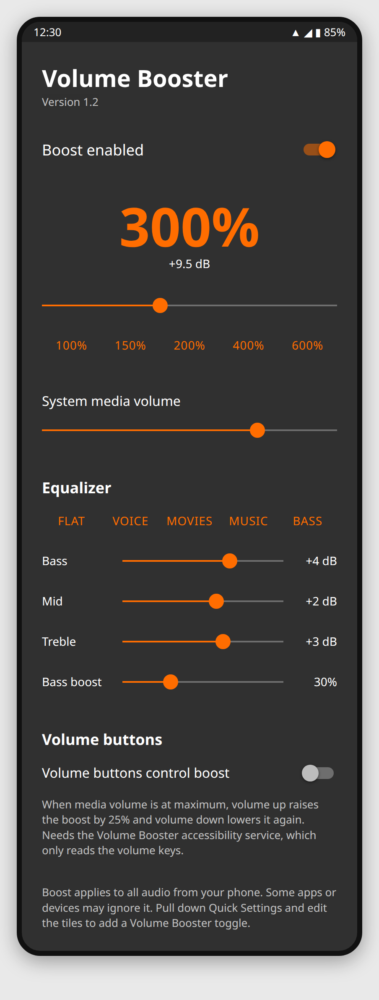

# Volume Booster

Android app that boosts audio output up to 600% using the platform `LoudnessEnhancer` effect, with an equalizer and bass boost.



*Mockup of the main screen (version 1.2), drawn from the app's layout. Not a screenshot from a real phone. Version 1.3 hides the Volume buttons section.*

- Boost slider from 100% to 600% (600% ≈ +15.6 dB) with presets
- Equalizer (bass, mid, treble) with Flat, Voice, Movies, Music and Bass presets, plus bass boost
- Volume buttons controlling the boost: **suspended in 1.3**, because phones may block sideloaded apps that use an accessibility service. The code is kept in `VolumeKeyService.kt`; see the note in `AndroidManifest.xml` to restore it.
- Runs as a foreground service with a notification: −25%, +25% and Stop
- Quick Settings tile to toggle the boost
- System media volume slider
- Warning before enabling more than 200%

Works on Android 7.0 (API 24) and newer. It attaches to the global output mix (session 0) and to every audio session that players announce. Some devices refuse the global effect; the boost then only applies to apps that announce their session.

## Build

Requires JDK 17+ and the Android SDK (API 36).

```bash
./gradlew assembleRelease
```

The APK is written to `app/build/outputs/apk/release/app-release.apk`.

## Warning

High boost levels can distort audio, damage speakers, and harm your hearing. Start with a low media volume.
